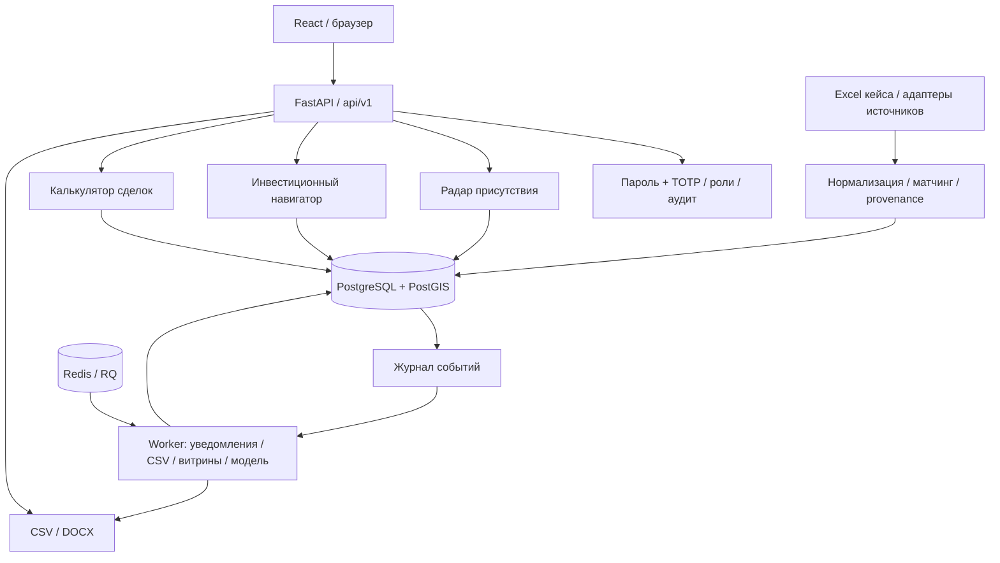

# Архитектура и состояние backend

Ветка: `backend-upd`. Проект хакатона: «Экосистема коммерческого блока», кейс ПАО «Ростелеком».
Продукт — веб-приложение. Backend обслуживает три связанных модуля: радар присутствия,
инвестиционный навигатор и калькулятор сделок. Telegram-бот для MVP не требуется.

## Пользовательский сценарий

Регион / муниципалитет → перспективная зона → компания → инвестиционный проект →
потребности и закупки → расчёт сделки → утверждение цены → DOCX / CSV / CRM.

| Модуль | Задача | Результат |
|---|---|---|
| Радар присутствия | Найти перспективные сегменты | Компании, метрики, карта потенциала, белые пятна и наблюдения источников |
| Инвестиционный навигатор | Выбрать проект и момент контакта | Проекты, инициаторы, стадии, таймлайн, потребности, закупки, подписки |
| Калькулятор сделок | Подготовить предложение | Себестоимость, аналоги, ценовая вилка, утверждение и редактируемое КП |

## Схема системы

HTTP-слой читает нормализованные данные и принимает запросы. Импорт, обучение модели,
подготовка витрин и большие CSV выполняются отдельно. Исходная запись, её источник
и дата сохраняются вместе с результатами нормализации.

## Стек и каталоги

Python 3.12, FastAPI, SQLAlchemy 2, Alembic, PostgreSQL/PostGIS, Redis, RQ,
APScheduler, openpyxl, scikit-learn и python-docx. Frontend: React, TypeScript, Vite.

| Каталог | Содержимое |
|---|---|
| `backend/app/` | API, авторизация запросов, конфигурация, модели, схемы и worker |
| `backend/modules/` | Бизнес-логика радара, навигатора, калькулятора, входа, экспорта и уведомлений |
| `backend/ingestion/` | Чтение Excel, источники, нормализация и сопоставление объектов |
| `backend/ml/` | Скоринг, правила потребностей и расчёт цены |
| `backend/alembic/` | Пять миграций: 43 таблицы и три materialized view |
| `backend/tests/` | HTTP, бизнес-логика, миграции и интеграция с сервисами |
| `data/case/` | Данные кейса и каталог калькулятора |
| `data/seed/` | Синтетический набор для отдельной демонстрации |
| `infra/` | Контейнеры, локальный запуск и тестовое окружение |

## Реализовано

- Импорт 759 компаний и 63 проектов; ещё 60 инициаторов создаются без выдуманного ИНН.
  Повторный импорт не создаёт дубли; изменения сохраняют историю источников.
- Карточки компаний и проектов, справочники, финансовые метрики, география и таймлайн.
  Годовые даты не выдаются за точные; неизвестные значения остаются `null`.
- Радар с единым отчётным годом, устранением дублей источников, YoY соседних лет,
  стабильной нормализацией и муниципальными срезами. Белые пятна требуют данных присутствия.
- Рыночные наблюдения с доказательством, источником и уровнем уверенности.
  Наблюдение ИНН в другом регионе не считается подтверждением открытия филиала.
- Личные сохранённые фильтры и основной фильтр на модуль.
- Обязательная MFA, первоначальная настройка TOTP, резервные коды, блокировки,
  refresh-cookie, CSRF, ротация, отзыв сессий, роли и аудит.
- Связанный путь от проекта до расчёта, утверждения менеджером и DOCX.
  Чужие расчёты и файлы закрыты; внутреннее обоснование имеет отдельные права.
- CSV/CRM компаний и проектов; большие выгрузки имеют задачу, статус, повторы,
  восстановление после сбоя и защищённое скачивание.
- Журнал событий, частоты подписок, квитанции доставки и устранение дублей уведомлений.
  Проверена обработка 620 событий и экспорт 5003 строк.
- Подготовленные витрины карты, белых пятен и таймлайна; подписанная модель калькулятора.
  Обучение не выполняется в HTTP-запросе, устаревшая модель включает резервный расчёт.

## Проверки и границы прототипа

154 переносимых теста прошли; 21 интеграционная проверка требует PostgreSQL/PostGIS и
Redis. Ruff, генерация SQL миграций и конфигурации Compose проверены. Uvicorn и Swagger
запускались без Docker. Пространственные операции, реальные MV, конкурентность PostgreSQL
и обработка RQ должны быть подтверждены интеграционным прогоном на сервере.

Радар использует эвристику, потребности определяются правилами, история сделок
калькулятора содержит синтетические примеры. Эти результаты не подтверждают точность
прогноза на реальных продажах. Адаптеры ФНС/ЕИС требуют согласованного доступа;
текущий воспроизводимый источник — приложенный Excel.

Для приёмки остаются серверный запуск, полный прогон тестов, подключение контрактов
командой frontend и измерение времени ответа относительно требования двух секунд.

## Документы для проверки

- [Сценарий демонстрации и критерии](hackathon-demo.md)
- [Запуск на сервере](server-deployment.md)
- [Импорт кейса и API данных](case-data-api.md)
- [Вход, сессии и права](auth-and-access.md)
- [Фильтры, события и фоновые задачи](background-and-run.md)
- [Колонки экспортов](export-mapping.md)
- [Исходное ТЗ](instructions.pdf)
