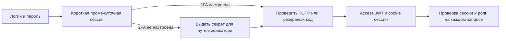

# Вход, сессии и права доступа

Ветка `backend-upd`. Все пути ниже — относительно `/api/v1`.
Рабочие правила ролей выбраны для текущего MVP; командное разделение расчётов можно
расширять отдельно. Проверки выполняются сервером.

## Вход и первоначальная настройка



1. `POST /auth/login`, JSON `{"login":"...","password":"..."}`.
   Ответ: `mfa_required=true`, `partial_token`, `mfa_setup_required`.
   Рабочих токенов и cookie на этом шаге нет, независимо от состояния 2FA.
2. При `mfa_setup_required=true`: `POST /auth/2fa/setup`,
   JSON `{"partial_token":"..."}`. Ответ содержит `secret` и `otpauth_hint` —
   URI для аутентификатора. Секрет выдаётся один раз для этого partial-токена;
   повторная выдача — 409. Если ответ потерян, нужно снова войти по паролю.
   Пользователь пока не получает доступ, его фактор ещё не включён.
3. `POST /auth/2fa/verify`, JSON `{"partial_token":"...","code":"123456"}`.
   При первой настройке проверяется TOTP из выданного секрета. При обычном входе
   принимается TOTP или оставшийся резервный код.
4. Ответ: `access_token`, `token_type=bearer`, `expires_in`, `csrf_token`,
   `backup_codes`. Последнее поле содержит восемь кодов только после подтверждения
   первоначальной настройки; при остальных входах оно `null`.
   Refresh-токен отсутствует в JSON и устанавливается только cookie.
5. Для рабочих запросов: `Authorization: Bearer <access_token>`.
   `GET /auth/me` возвращает id, login, текущую роль и состояние 2FA.

Промежуточная сессия действует по умолчанию 5 минут и используется один раз.
Секрет ожидающей настройки шифруется в `partial_auth`; после подтверждения — в пользователе.
Резервные коды хранятся как Argon2-хеши и расходуются при использовании.
Принимаются соседние временные интервалы TOTP, но уже принятый счётчик повторно не проходит,
в том числе с другим partial-токеном. Для повторного входа в тот же интервал нужен
следующий код аутентификатора или неиспользованный резервный код.

Неудачи учитываются не только по IP/partial-токену, но и в самой учётной записи:
новый парольный challenge не обнуляет ошибки второго фактора. По умолчанию после
5 неудач аккаунт блокируется на 15 минут; успешное полное подтверждение сбрасывает счётчик.
Дополнительные ограничения попыток работают через Redis. Только в `APP_ENV=dev|test`
допускается локальный fallback; в остальных окружениях недоступность Redis даёт 503.

## Cookie, обновление и выход

| Cookie | Свойства |
|---|---|
| `rtk_refresh` | HttpOnly, SameSite=Strict, без Domain, Path=`/api/v1/auth` |
| `rtk_csrf` | Доступна JS для заголовка CSRF, SameSite=Strict, без Domain, Path=`/` |

`Secure` включён по умолчанию вне `dev/test`; отключение через
`AUTH_COOKIE_SECURE=false` там запрещено конфигурацией. Локальный HTTP использует
`APP_ENV=dev` с автоматически отключённым Secure. Для HTTPS в dev можно явно установить
`AUTH_COOKIE_SECURE=true`. Внешний HTTPS-адрес и CORS origins задаются при развёртывании.

`POST /auth/refresh` не принимает токен в URL или JSON. Нужны браузерные cookie и
`X-CSRF-Token`, совпадающий с `rtk_csrf`/значением `csrf_token` последнего ответа.
Сервер также проверяет источник запроса и хеш CSRF, привязанный к сессии в БД.
При успехе меняются access, refresh и CSRF; старые access и refresh сразу отзываются.
Параллельные refresh клиент должен объединять в один запрос.

В БД сохраняются SHA-256-хеши случайных refresh/CSRF, а не их исходные значения.
Ротация однократна и не продлевает исходное время жизни сессии, по умолчанию 7 дней.
Access JWT живёт по умолчанию 15 минут и дополнительно привязан к действующей
серверной сессии и версии авторизации пользователя.

`POST /auth/logout` использует те же cookie и CSRF. Выход отзывает всю цепочку ротации
текущего браузера и очищает обе cookie; даже запоздавший logout со старой cookie
отзывает уже обновлённую сессию этой цепочки. Другие входы пользователя сохраняются.
Все ответы `/auth/*`, включая ошибки, помечаются `Cache-Control: no-store`.

## Правила ролей

| Действие | manager | analyst | admin |
|---|---|---|---|
| Компании, проекты, радар, справочники и общий CSV | Да | Да | Да |
| Создать расчёт | От своего имени | От своего имени | От своего имени |
| Утвердить цену | Свой расчёт | Нет | Любой расчёт |
| Клиентский DOCX и CSV калькулятора | Свой расчёт | Свой расчёт | Любой расчёт |
| Внутренний DOCX с обоснованием | Нет | Свой расчёт | Любой расчёт |
| Прежний DOCX `/exports/proposal` | Свой расчёт | Свой расчёт | Любой расчёт |
| `GET /audit` | Нет | Нет | Да |

Чужой или отсутствующий расчёт возвращает 404. Запрет действия по роли — 403.
Расчёты без автора доступны только администратору. Проверка выполняется до чтения
выгрузки или изменения цены, включая `id=0`, чтобы он не превращался в выгрузку всех строк.
Автор расчёта берётся из текущей сессии. Существование company/project/calc-region
и соответствие компании инициатору проверяются перед созданием расчёта.
Роль читается из БД: старая роль в подписанном JWT не сохраняет прежние права.

У старого `/exports/proposal` ответ теперь содержит `download_url`, без локального
`file_ref`. Генерация и скачивание используют одну проверку владельца; файл скачивается
только из настроенного каталога экспортов.

## Восстановление и миграция

Публичный `POST /auth/2fa/disable` возвращает 409: выключить обязательную 2FA через
рабочую сессию нельзя. Для утраченного аутентификатора используются резервный код
или доверенная команда администратора на сервере:

```text
python -m app.cli enable-2fa --email user@example.com
```

Команда заменяет секрет и резервные коды, повышает `auth_version` и отзывает все
предыдущие рабочие и промежуточные сессии. Выведенные секрет/коды предназначены
только владельцу учётной записи. Новый вход всё равно требует подтверждения кода.
Внутренний административный сброс фактора также отзывает сессии и оставляет
пользователя без доступа до новой настройки, без парольного обхода.

Нужен `alembic upgrade head`: ревизия `20261025_0004` добавляет состояние MFA,
счётчик повторов, версии и цепочки сессий. Она намеренно отзывает старые refresh
и удаляет старые partial-токены: пользователям потребуется войти заново.
Откат этой ревизии тоже очищает сессии; компании, проекты и расчёты сохраняются.

## Аудит и проверка

Записываются парольные неудачи/блокировки, начало настройки, включение/сброс MFA,
неудачи и подтверждение второго фактора, ротация и выход; создание расчётов обоих
калькуляторов, утверждение цены, CSV и DOCX. Изменение цены и создание нового расчёта
записываются в аудит в той же транзакции. До/после сохраняются хешами, без сырого
входа, паролей, TOTP, резервных кодов и токенов.
`GET /audit` поддерживает `action`, `user_id`, `limit` 1–500 и неотрицательный `offset`.

HTTP-тесты покрывают начальную настройку, одноразовость, блокировку, истечение,
деактивацию аккаунта, cookie/CSRF, ротацию, выход, смену роли, чужие id и аудит.
Отдельные PostGIS-тесты запускают конкурентное подтверждение TOTP, резервного кода,
refresh и гонку logout/refresh на разных подключениях. Локально эти конкурентные
тесты пропускаются из-за недоступных PostgreSQL/Docker; их выполнение обязательно
в CI с `REQUIRE_INTEGRATION=1`.

Переносимый набор: **154 passed**, 21 интеграционная проверка запускается с реальными
PostgreSQL/PostGIS и Redis. Ruff проходит; offline SQL покрывает upgrade/downgrade
пяти ревизий. Применение миграций и конкурентность требуют серверной приёмки.

## Стык с frontend

- Показать настройку аутентификатора при `mfa_setup_required=true`; при обычном входе
  оставить существующий ввод кода. Резервные коды после настройки показать один раз.
- Для verify, refresh и logout передавать `credentials: 'include'`; access хранить
  в памяти, для рабочих запросов использовать Bearer.
- Для refresh/logout передавать актуальный `X-CSRF-Token`; после refresh обновлять
  access и CSRF совместно. При перезагрузке страницы CSRF читается из cookie.
  Рекомендуется один origin через существующий proxy; для отдельных origins нужны
  разрешённый CORS, cookie-политика браузера и согласованный HTTPS-домен.
- Обновить тип ответа verify: `refresh_token` удалён. Добавить обновление сессии и
  выход; старый frontend пока использует только login/verify/me.
- Учитывать права на утверждение/внутренний DOCX и новый `download_url` старого экспорта.

Клиентская команда подключает эти контракты при общей проверке приложения.
Серверная приёмка включает работу сессий и HTTPS/CORS в окружении демонстрации.

Основания для cookie-политики: [OWASP Session Management](https://cheatsheetseries.owasp.org/cheatsheets/Session_Management_Cheat_Sheet.html),
[Starlette Response.set_cookie](https://starlette.dev/responses/).
