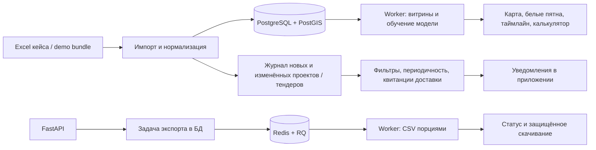

# Фоновые задачи, новые API и запуск без Docker

Ветка `backend-upd`. Контракты фоновых задач и порядок запуска.
Продукт — веб-приложение. Этот этап затрагивает только backend.

## Что добавлено



Схема Alembic: **пять ревизий, 43 таблицы и три materialized view**.
Ревизия `20261025_0005` добавляет журнал событий, квитанции доставки, фоновые задачи,
версии данных, подготовленные ответы и артефакт модели. Старые уведомления и рыночные
сигналы сохраняются: новые записи имеют отдельные уникальные ключи.

## Контракт для frontend

Все маршруты ниже начинаются с `/api/v1`, требуют access token после второго фактора
и работают с текущим пользователем. Cookie/CSRF и роли описаны в
[auth-and-access.md](auth-and-access.md).

| Действие | Маршрут | Поведение |
|---|---|---|
| Сохранённые фильтры | `GET /saved-filters?module=companies&limit=100&offset=0` | Только свои; модули `companies`, `radar`, `investments` |
| Создать фильтр | `POST /saved-filters` | `201`; поля `module`, `name`, `filters`, `is_default` |
| Изменить / удалить | `PATCH /saved-filters/{id}`, `DELETE /saved-filters/{id}` | Чужой id → `404`, включая администратора |
| Рыночные наблюдения | `GET /radar/insights` | Фильтры `region_id`, `industry_group`, `municipality`, `signal_type`; `limit`, `offset` |
| Подписки | `GET /subscriptions`, `POST /subscriptions` | `module`, `filters`, `notify_frequency`; список с `limit`, `offset` |
| Изменить подписку | `PATCH /subscriptions/{id}` | `filters`, `notify_frequency`, `is_active` |
| Удалить подписку | `DELETE /subscriptions/{id}` | Только владелец |
| Уведомления | `GET /notifications` | `unread_only`, `limit` от 1 до 500, `offset` |
| Большой CSV / CRM | `POST /exports` | `202`, возвращает долговечную задачу; Redis не нужен для самого принятия запроса |
| Состояние задачи | `GET /tasks/{id}` или `GET /exports/{id}` | Владелец или admin; чужой id → `404` |
| Скачать CSV | `GET /exports/{id}/download` | Владелец или admin; до готовности `409` |
| Небольшой CSV | `POST /exports/csv` | До 5000 строк; превышение → `413` с предложением фонового экспорта |

Пример фильтра:

```json
{"module":"companies","name":"Ростов","filters":{"region_id":1},"is_default":true}
```

В ответе сохранённые условия находятся в `filters_json`. Назначение фильтра основным
снимает этот признак у других фильтров того же пользователя и модуля. Операции
сериализуются блокировкой строки пользователя. Неизвестные условия и явный `null`
в PATCH отклоняются. Фильтры радара соответствуют параметрам карты; условия списка
компаний сохраняются с `module=companies`.

Пример запроса экспорта:

```json
{"module":"investments","mode":"general","filters":{"region_id":1}}
```

Ответ содержит `id`, `status`, `attempts`, даты, `status_url`, `download_url` и `error`.
Статусы: `pending` → `running` → `done`; после исчерпания трёх попыток — `failed`.
`download_url` появляется только при `done`. Frontend опрашивает `status_url`, затем
скачивает файл с заголовком авторизации. Внутренний путь файла клиенту не передаётся.
Формат CSV, BOM, колонки и защита от формул общие с синхронным экспортом; см.
[export-mapping.md](export-mapping.md).

## Уведомления и наблюдения

Импорт записывает событие в той же транзакции, что и проект или тендер. Повтор той же
версии источника не создаёт второе событие. Доставка обрабатывает все доступные события
порциями по 250; ограничение последними 50 объектами удалено. Фильтры проверяются по
снимку объекта в момент события. Квитанции подписки и уведомление сохраняются атомарно.
Сбой до commit допускает безопасный повтор. Пересекающиеся подписки пользователя
создают одно уведомление на событие.

Частоты: `immediate`, `hourly`, `daily`, `weekly`. Worker проверяет очередь раз в минуту;
`immediate` означает ближайшую такую проверку. После первого прохода остальные частоты
ограничивают интервалы до 1 часа, 1 дня и 7 дней. Новая подписка получает события,
возникшие после её создания; исторический список не рассылался задним числом.
Доставка выполняется внутри приложения. Telegram-бот не требуется.

Сигнал `new_registry_company` основан на явной отметке исходного реестра. Сигнал
`cross_region_observation` означает наблюдение одного проверенного ИНН в разных
регионах. Он требует проверки и **не подтверждает** открытие филиала. Синтетические
источники не создают эти сигналы. API возвращает доказательство, источник, дату,
уровень уверенности и версию эвристики. Федеральная экспансия из названия не выводится.

## Витрины, модель и worker

Worker готовит семь наборов ответов: радар и белые пятна по регионам/муниципалитетам,
таймлайн по месяцам/кварталам/годам. PostgreSQL хранит их в `mv_region_density`,
`mv_white_space`, `mv_investment_timeline`. У каждого набора есть версия данных,
дата и версия алгоритма. При изменении данных, смене дня или возрасте более часа
API использует текущий расчёт. Для нестандартного отчётного года, выбранной услуги
и муниципального таймлайна также предусмотрен текущий расчёт.

Три MV имеют полные уникальные индексы и создаются заполненными, чтобы использовать
`REFRESH MATERIALIZED VIEW CONCURRENTLY`, согласно
[PostgreSQL 16](https://www.postgresql.org/docs/16/sql-refreshmaterializedview.html).

Калькулятор загружает артефакт, подготовленный seed/worker. Подпись HMAC проверяется
до десериализации. Отпечаток включает содержимое обучающих сделок и регионов;
изменение строки при прежнем числе сделок тоже делает модель устаревшей. Обучение
в HTTP-запросе не выполняется. При отсутствии актуальной модели доступен резервный
расчёт с предупреждением в ответе.

Расписание: уведомления и диспетчер экспортов — раз в минуту, витрины — раз в 5 минут,
скоринг/модель — раз в 30 минут, ingestion — по `INGEST_CRON` при `INGEST_ENABLED=true`.
Повторные тики объединяются, пока предыдущая работа стоит в очереди или выполняется.
RQ делает повторы с паузами 10/30 секунд; включён встроенный scheduler для этих повторов.
Зависшие экспорты восстанавливаются после окончания аренды в 660 секунд; публикация
файла проверяет токен аренды. Файл пишется порциями по 500 строк в согласованном
снимке PostgreSQL и публикуется после завершения.

## Запуск без Docker на Windows

Docker — способ поставки окружения. Backend можно запустить обычным Python.
Нужны Python 3.12+, доступные **PostgreSQL с PostGIS** и **Redis**. Сервисы могут
находиться на другом сервере; укажите их адреса в `.env`. SQLite используется в
переносимых тестах и не заменяет рабочую PostgreSQL/PostGIS.

В проекте уже настроено `backend/.venv`. Для нового окружения установите зависимости:

```powershell
cd backend
.\.venv\Scripts\python.exe -m pip install -c constraints.txt -e ".[dev]"
cd ..
```

В корневом `.env` задайте `DATABASE_URL` и `REDIS_URL`; секретные ключи не публикуйте.
Для новой БД расширение PostGIS можно создать заранее под администратором PostgreSQL:
`CREATE EXTENSION IF NOT EXISTS postgis;`. У пользователя приложения должны быть права
владельца схемы для миграций и обновления витрин.

Из корня репозитория:

```powershell
.\infra\scripts\native.ps1 check
.\infra\scripts\native.ps1 init
.\infra\scripts\native.ps1 user -Email manager@example.com -Role manager
.\infra\scripts\native.ps1 api
```

В другом терминале:

```powershell
.\infra\scripts\native.ps1 worker
```

`init` создаёт `.env` со случайными ключами, если файла ещё нет, проверяет сервисы,
применяет миграции, загружает кейс и калькулятор, готовит витрины/модель.
`check` до создания `.env` завершится с понятной инструкцией. Для другого окружения
передайте `-PythonPath C:\path\to\python.exe`. API и worker работают, пока открыты
соответствующие терминалы. В Windows используется RQ `SimpleWorker` с таймером;
в Linux — обычный `Worker`. Ограничения SimpleWorker описаны в
[документации RQ](https://python-rq.org/docs/workers/); рабочий Linux-worker остаётся
основным вариантом поставки.

Swagger: `http://localhost:8000/docs`. `/health` проверяет процесс; `/api/v1/ready`
проверяет PostgreSQL, текущую ревизию Alembic и Redis. `503` показывает недоступный
компонент без строк подключения и секретов.

Эквивалент ручной инициализации из `backend/`:

```powershell
.\.venv\Scripts\python.exe -m alembic upgrade head
.\.venv\Scripts\python.exe -m app.cli bootstrap-data
.\.venv\Scripts\python.exe -m modules.deal_calculator.seed
.\.venv\Scripts\python.exe -m app.cli refresh-views
```

## Что проверено и что остаётся

PostgreSQL/PostGIS и Redis настраиваются в целевом серверном окружении.
Порядок запуска и приёмки: [server-deployment.md](server-deployment.md).

**154 переносимых теста прошли** (`pytest -m "not integration"`).
21 интеграционная проверка требует реальных PostgreSQL/PostGIS и Redis.
Ruff проходит; offline upgrade/downgrade генерирует PostgreSQL-схему всех таблиц.
Проверены 620 событий, пересекающиеся подписки, частоты и rollback, экспорт 5003 строк,
повторы и аренда задач, доступ к файлам, равенство готовых/живых расчётов, сигналы,
обновления импорта, актуальность и подпись модели.

Нативный Uvicorn запускался: `/health` → `200`, Swagger и 48 путей OpenAPI доступны.
Без PostgreSQL и Redis `/api/v1/ready` возвращает `503`. Полный запуск приложения
подтверждается только после настройки сервисов и прохождения серверных проверок.

Остаётся для приёмки:

1. Предоставить PostgreSQL/PostGIS и Redis, выполнить `native.ps1 init` либо Compose.
2. Запустить полный набор с `REQUIRE_INTEGRATION=1`: реальные миграции, MV,
   конкурентная доставка/аренда, RQ и контроль схемы. Локальные SQLite-проверки
   не подтверждают работу этих механизмов PostgreSQL/Redis.
3. Пройти сценарий с frontend и замерить ответы на целевом окружении относительно 2 секунд.
   Новые MFA/cookie/CSRF, фильтры и фоновые выгрузки требуют подключения клиентской командой.

Конфигурация CI включает PostgreSQL/PostGIS и Redis с обязательной интеграцией.

Полный pytest запускайте на **отдельной тестовой БД**, а не на БД с данными демонстрации:
часть существовавших тестов загружает demo seed в общую схему. Compose-команда
`infra/scripts/dev.ps1 test` уже создаёт отдельное окружение. Для ручного запуска
укажите `DATABASE_URL` тестовой БД и отдельный Redis DB/инстанс, примените миграции,
затем задайте `$env:REQUIRE_INTEGRATION='1'` и выполните pytest.
