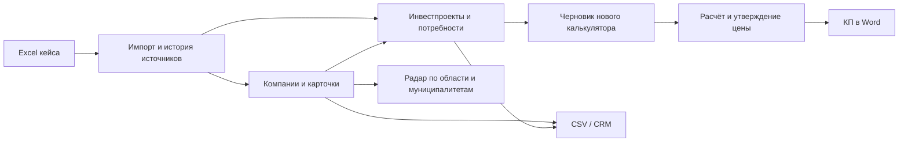

# Данные кейса и связанный backend

Ветка `backend-upd`. Общая схема данных и миграции описаны в
[backend-foundation.md](backend-foundation.md). Документ задаёт контракты для клиентской команды.



## Что загружается

По умолчанию `DATA_MODE=case`. `bootstrap-data` и init-контейнер импортируют
`data/case/case_data_2026.xlsx`; калькулятор отдельно загружает свой подготовленный каталог.
Плановый `run_ingestion` при `INGEST_ENABLED=true` использует тот же выбранный режим.

| Объекты | Количество и смысл |
|---|---|
| Компании из листа МСП | 759, все ИНН проходят контрольные разряды |
| Инвестпроекты | 63, бюджет переводится из млн рублей в рубли |
| Дополнительные компании | 60 инициаторов, отсутствующих в листе МСП; ИНН остаётся `null` |
| Всего компаний | 819 после первого импорта в пустую БД |
| Регион | Ростовская область, устойчивый код `RU-ROS-RND` |
| Отрасли | 13 бизнес-групп; у компаний выводятся по префиксу ОКВЭД, у проектов — по описанию |
| Выручка и присутствие | В исходной книге отсутствуют; не создаются искусственно |
| Отбракованные строки исходной книги | 0; отчёт импорта содержит `issues` для ошибок других версий файла |

Листы распознаются по колонкам: фактическое имя листа проектов `МОД"_Таб1`
не мешает импорту. Сохраняются исходная строка, файл, лист, номер строки, hash,
дата получения и пояснение происхождения. Идентичная загрузка не создаёт новые
компании, проекты, источники, матчинги, события, milestones или потребности.
Изменённая строка обновляет текущую запись и сохраняет старый источник.

Инициаторы сопоставляются по нормализованному названию и региону только при одном
кандидате; метод `name_region` и уверенность 0.75 хранятся в `CompanyMatch`.
Неоднозначное совпадение не объединяет компании. Полные организационные формы
нормализуются вместе с ООО/АО/ИП. Известная численность 0 сохраняется.
Запись из demo не перезаписывает описание уже известной компании из обычного источника.

## API

Все перечисленные маршруты находятся под `/api/v1` и требуют авторизации.

| Маршрут | Результат |
|---|---|
| `GET /regions` | Общие регионы, код, родитель, известные координаты центра |
| `GET /regions/{id}/municipalities` | Муниципалитеты из компаний и проектов |
| `GET /industries` | Отрасли с бизнес-группой |
| `GET /dictionaries/{code}` | Контролируемый словарь, например `project_stage` |
| `GET /positions/prices` | Каталог прежнего калькулятора; в режиме case может быть пуст |
| `GET /calculator/catalog` | Основной каталог и регионы нового калькулятора |
| `GET /sources/{id}` | Происхождение, hash, лицензия/пояснение и исходный JSON |
| `GET /companies` | Компании; фильтры применяются до пагинации |
| `GET /companies/{id}` | Компания, метрики, проекты, сигналы спроса, источники и ограничения |
| `GET /companies/{id}/metrics` | Одна каноническая запись на показатель и год |
| `GET /radar/heatmap` | Областные или муниципальные агрегаты, качество и вклады факторов |
| `GET /radar/white-spaces` | Только зоны с известным присутствием и финансовой опорой |
| `GET /investments` | Проекты с муниципалитетом, годами и методом определения стадии |
| `GET /investments/{id}` | Карточка с milestones, источником, потребностями через отдельный маршрут |
| `GET /investments/{id}/needs` | Объяснения потребностей; для отсутствующего проекта 404 |
| `GET /investments/timeline` | Периоды и связанные проекты; годовые даты не распределяются по месяцам |
| `GET /calculator/draft/{project_id}` | Связанный черновик, id компании и маппинг региона по коду |
| `POST /exports/csv` | Компании/проекты, режимы general/CRM, одинаковые с API фильтры |

Списки сохраняют форму массива. `limit` от 1 до 500, `offset` неотрицательный.
Экспорт синхронный, до 5000 строк, UTF-8 BOM, имя файла уникально для запроса.
Полный маппинг: [export-mapping.md](export-mapping.md).

## Правила радара

Выручка компании — последний год либо явно выбранный `report_year`. За один год
выбирается один источник: обычный перед синтетическим, затем дата получения и
стабильный id; размер выручки не влияет на приоритет. YoY требует соседнего
предыдущего года с положительной базой; известный текущий ноль даёт -100%,
пропущенный год не даёт ложную «годовую» динамику.

Агрегаты используют единый отчётный год и одну строку финансов на компанию.
В ответе есть `revenue_year`, `revenue_companies`, `growth_companies`:
пользователь видит охват данных. Нормализация и пороги P75/P25 считаются по общему
набору до выбора региона/отрасли, поэтому отображающий фильтр не меняет оценку.
Радар и белые пятна используют одинаковые проекты, тендеры и оценки.

Присутствие выбирается по последнему непозднее сегодняшнего дня срезу услуги
и территории. Областное покрытие не становится подтверждением контракта отдельной
компании или муниципалитета. Неизвестное покрытие остаётся `null` и не создаёт
«белое пятно». В case-режиме пустой список белых пятен ожидаем до появления данных
присутствия. Потенциал остаётся экспертной эвристикой с ограниченным качеством,
когда части признаков нет. Запросы пока выполняют SQL-агрегацию, материализованных
витрин ещё нет; производительность на рабочем PostgreSQL не измерена.

## Изменения для frontend

1. `revenue_sum`, `growth_share`, `presence_score`, выручка и YoY могут быть `null`:
   показывать «нет данных». Денежный Decimal сериализуется строкой, не подменять `null` нулём.
2. `is_synthetic` описывает объект/агрегат; `revenue_is_synthetic` отдельно отмечает
   синтетическую финансовую опору компании, метрики также содержат `is_synthetic`.
3. Стадия проекта может быть `unknown`; `stage_method=rule_based` — оценка по описанию,
   а не подтверждение текущего хода работ. В карточке есть доказательство и предупреждение.
4. Для исходной книги `start_precision/end_precision=year`; точные
   `planned_start/planned_end` равны `null`, используются `planned_start_year/planned_end_year`.
   Milestones возвращают `year`, `date_precision` и `date=null`.
5. Таймлайн при запросе месяца всё равно возвращает `period=YYYY`, `date_precision=year`
   для годового события. Такие события нельзя рисовать как состоявшиеся 1 января.
6. Муниципальная карта: `level=municipality` или фильтр `municipality`.
   Координат в книге нет; `longitude/latitude=null`, нужны подтверждённые границы/центры.
   Генерировать фиктивные точки нельзя.
7. Общие `region_id` и id из `/calculator/catalog` различаются. Черновик уже
   переводит их через код; не передавать общий id прямо в калькулятор.
8. Черновик из годовых дат отдаёт `duration_months=null`; оценочная площадь явно
   отмечена в `explain.area_is_estimated`. Менеджер должен уточнить эти параметры.
9. CSV получит ту же выборку, только если клиент передаст в `filters` все активные
   фильтры. Локальный фильтр UI backend сам не видит. Для проверки отключить моки клиента.

## Запуск и проверка

Миграция `20261025_0003` добавляет географию/происхождение компаний, признаки синтетики
и точность дат. Команды из `backend/` при доступном PostgreSQL/PostGIS:

```text
alembic upgrade head
python -m app.cli bootstrap-data
python -m modules.deal_calculator.seed
python -m app.cli import-case --workbook ../data/case/case_data_2026.xlsx
```

Локальные проверки включают исходную книгу целиком, повторный импорт, изменение
строки, единицы бюджета, известный ноль, источники, дубли финансов, соседние годы,
стабильность скоринга и HTTP-путь проект → черновик → расчёт → утверждение → DOCX/CSV.
Для бизнес-проверок на SQLite только неиспользуемые пространственные столбцы временно
заменяются текстовыми в fixture; это не проверка PostGIS. Отдельный интеграционный
тест выполняет импорт и радар на схеме PostgreSQL после настоящих миграций.

Переносимый набор: **154 passed**. 21 интеграционная проверка требует реальных сервисов.
Ruff и конфигурации обоих Compose-стеков проходят; SQL upgrade/downgrade проверен offline.
Живые PostGIS/Redis-тесты и контейнерный запуск проверяются в серверном окружении.
CI и `infra/scripts/dev.ps1 test` запускают интеграцию с `REQUIRE_INTEGRATION=1`,
при котором недоступность сервиса является ошибкой.

## Что остаётся до общей готовности

Обязательная 2FA, refresh-cookie, роли и владение расчётами описаны в
[документации доступа](auth-and-access.md). События, частоты подписок, сохранённые фильтры,
рыночные наблюдения, витрины и фоновые выгрузки реализованы; их контракты — в
[background-and-run.md](background-and-run.md). Остаются подключение контрактов frontend,
серверная приёмка и измерение времени ответа на PostgreSQL. Синтетическая история
калькулятора не подтверждает точность модели на реальных продажах.
